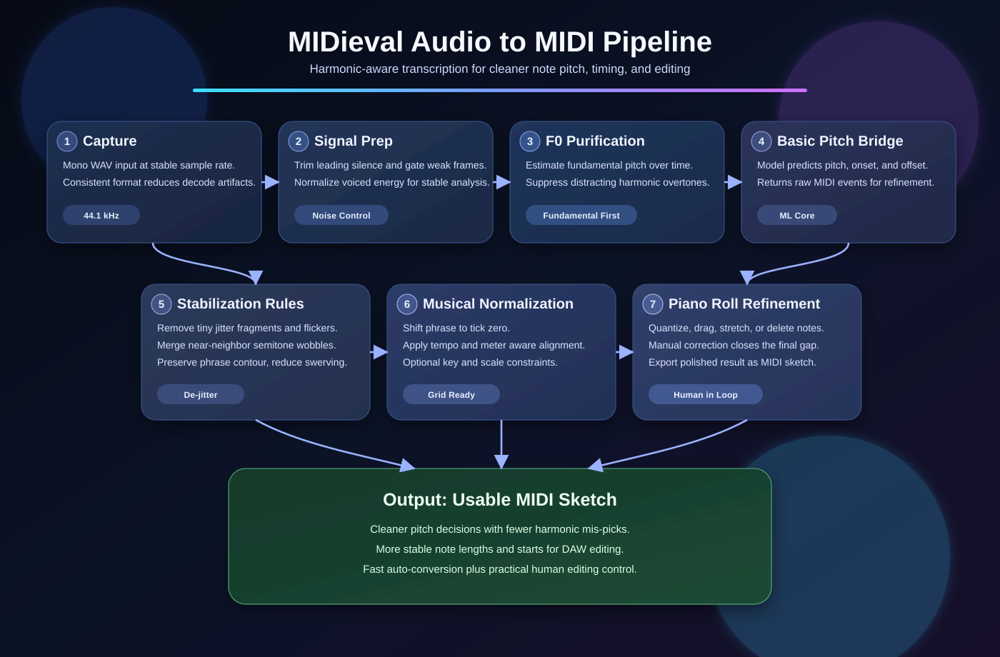
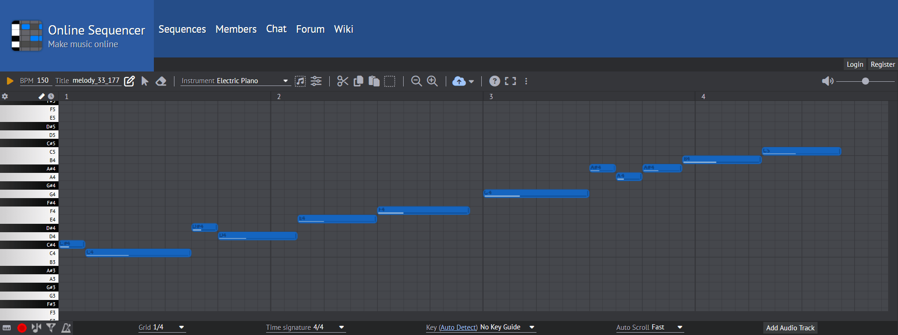

# MIDieval

MIDieval is a Flutter prototype for capturing short hummed melodies and turning them into clean MIDI sketches. The app lets a user record a WAV voice clip, save it to Supabase, play it back, and generate a downloadable `.midi` file that can be opened in a DAW or notation tool.

The core experiment is the audio-to-MIDI engine in `lib/midi_engine.dart`. It decodes mono WAV audio, estimates pitch, smooths unstable humming artifacts, groups the detected melody into notes, and quantizes simple phrases onto a musical grid.

## Problem This Project Tackles

Human voice is not a single pure tone. Even when we hear one clear sung note, the waveform contains many additional harmonic components (overtones), some of which are subtle and not consciously perceived. For audio-to-MIDI conversion, this is a major challenge: a computer can accidentally lock onto one of those harmonics instead of the true fundamental pitch.

That mismatch causes common errors such as:

- wrong detected note (for example octave or semitone mistakes),
- unstable note switching ("wobbling" notes),
- broken rhythm segmentation because pitch tracking is inconsistent.

MIDieval focuses on reducing that problem by stabilizing pitch detection, filtering unstable fragments, and snapping the result into usable musical notes for MIDI output.

### How The Current Algorithm Works (Short Technical Overview)

The current pipeline is hybrid: Flutter handles recording/workflow/editing, and a local Basic Pitch bridge handles transcription.

1. Audio capture and prep:
   - The app records mono WAV (44.1 kHz), which avoids extra codec artifacts from compressed formats.
   - Leading silence and low-energy noise are reduced so pitch detection starts on voiced material.

2. Harmonic handling before transcription:
   - In the bridge, an optional purification step estimates voice F0 (fundamental) over time.
   - The signal is then resynthesized into a cleaner monophonic track, which suppresses many distracting overtones.
   - This is the key defense against “wrong harmonic chosen as note”.

3. Basic Pitch transcription:
   - The purified (or fallback raw) signal is sent to Basic Pitch, which predicts note events (pitch + start/end).
   - Output is serialized to MIDI.

4. Post-transcription stabilization:
   - Very short note fragments are removed.
   - Neighboring near-unison/semitone wobble fragments are merged.
   - Micro-notes between stable notes are absorbed when they look like vocal modulation artifacts.

5. Musical normalization in app:
   - Notes are aligned to start at tick 0 (remove leading timing offset).
   - Optional constraints can be applied: locked tempo, locked meter, key/scale snapping.
   - Quantization in the editor uses meter-aware snapping and rhythm regularization for cleaner note lengths.

In practice, this means the app does not rely on a single raw pitch read. It combines purification, ML transcription, and rule-based post-processing to reduce harmonic confusion and produce usable MIDI sketches.



## Features

- Email authentication through Supabase.
- WAV recording at 44.1 kHz.
- Cloud storage for recorded audio clips and generated MIDI files.
- Playback for saved sketches.
- One-tap conversion from hummed audio to MIDI.
- Pitch cleanup for vibrato, scoops, harmonics, and short unstable fragments.
- Phrase quantization for simple monophonic lines such as a C major scale.

## ToDo / Changelog Checklist

This list tracks the project journey from the beginning.  
Rule going forward: before each commit, this section is updated.

- [x] Initial Flutter + Supabase app scaffold with auth and `sketches` storage.
- [x] Record voice clips as mono WAV (44.1 kHz) instead of compressed clip flow.
- [x] Basic one-tap audio -> MIDI conversion flow.
- [x] Multiple rounds of humming-stability tuning (less harmonic wobble / swivering).
- [x] Auto-align generated MIDI notes to timeline start (remove leading silence offset).
- [x] Better handling of staccato/short note fragmentation in conversion pipeline.
- [x] Add MIDI preview/editor dialog before final upload.
- [x] Add piano roll beat/bar grid.
- [x] Add piano roll drag editing (horizontal timing + duration resize).
- [x] Add piano roll vertical drag for pitch (replace button-based pitch up/down).
- [x] Fix inverted vertical drag direction on desktop.
- [x] Add note labels on blocks (C2, G#3, etc.).
- [x] Add undo/redo in piano roll (Ctrl+Z / Ctrl+Shift+Z and mobile buttons).
- [x] Add right-click note delete on desktop.
- [x] Add right-drag erase behavior on desktop piano roll.
- [x] Stabilize piano roll layout height (prevent weird shrink/stretch while editing).
- [x] Add quantize control with improved meter-aware snapping logic.
- [x] Improve quantize behavior across bars/beats for common quarter/eighth-note patterns.
- [x] Add conversion queue/background job states in UI.
- [x] Add generating/loading overlays and progress messages.
- [x] Improve play/stop button state reset after clip playback completes.
- [x] Improve clip playback quality and local pre-cache behavior.
- [x] Keep newly recorded clips visible immediately (session + Supabase sync).
- [x] Fix refresh action crash (`setState` async callback issue).
- [x] Add recording/session sketch merge logic (local optimistic rows + remote refresh).
- [x] Add random melody generator (key + scale + meter aware) and upload result.
- [x] Add conversion settings panel (tempo lock, meter lock, key/scale constraint).
- [x] Add mobile-friendly conversion settings layout.
- [x] Add profile/settings page.
- [x] Add language switch (English / Polish).
- [x] UI redesign pass (lighter, less square, new typography, better spacing).
- [x] Add celebration animation (jumping notes) on successful conversion.
- [x] Upgrade celebration effect to full-screen multi-burst note confetti.
- [x] Add app branding assets and integrate logo in auth/app bar.
- [x] Add adaptive Android launcher icon branding.
- [x] Move from ad-hoc naming to `Recording X` naming for recordings.
- [x] Keep sketch titles stable after conversion (do not overwrite with temporary MIDI label).
- [x] Change Supabase Storage naming to deterministic `recording_x` style (no timestamp).
- [x] Enable deterministic-name uploads with safe overwrite (`upsert`) for WAV.
- [x] Add and later remove diagnostics experiments to return to the stable pre-diagnostics conversion path.
- [x] README rewrite in English with clearer project/problem description.
- [x] Add prototype GIF section in README.
- [x] Add algorithm pipeline SVG to README.
- [x] Add detailed "Problem This Project Tackles" explanation in README.
- [x] Prepare local ML rhythm experiment route (`tool/ml_midi`) and training docs (archived path).
- [x] Add bridge docs for TorchCrepe and Basic Pitch routes.
- [x] Refactor `main.dart` into a thin bootstrap entry and move app implementation into dedicated files.
- [x] Split app implementation into focused files (`app_shell`, `profile_settings_page`, `home_page`, `midi_editor_dialog`).
- [x] Tune close-note handling to reduce accidental merges and preserve nearby melodic steps.
- [x] Improve key/scale constraint snapping with context-aware melodic direction scoring.
- [x] Fix buggy piano-roll note interactions: smooth drag movement and isolated resize behavior (no random neighboring note stretch/shrink).
- [x] Fix mixed-language localization leaks so default English mode no longer shows Polish tooltips/errors in key flows.
- [x] Bring back piano-roll note creation via double-click, with new notes inheriting duration from the currently selected note.
- [] Add hosted/production bridge reliability strategy (timeouts, retries, health fallback).
- [] Consider moving bridge inference on-device/native for mobile (future architecture option).
- [] Add smart rhythm repair presets (`Tight`, `Natural`, `Legato`, `Staccato`) that switch quantize/snap behavior profiles.
- [] Add export pack feature: bundle `.mid` + `original.wav` + `cleaned.wav` + conversion analysis JSON into one `.zip` for debugging/training.
- [x] Add first-run in-app tutorial overlay (~30 sec): `record -> convert -> quantize -> edit -> apply`, with auto-seeded C-major demo sketch for new accounts.
- [x] Upgrade tutorial UX to anchored overlay callouts with curved arrows pointing directly to key UI controls.
- [] Improve core conversion algorithm quality (pitch + rhythm) and reduce current high-error cases.

## Prototype Versions

The GIF below shows four prototype versions of the MIDI generator, from early rough detection to the cleaner current version.



## Tech Stack

- Flutter and Dart
- Supabase Auth, Database, and Storage
- `record` for audio capture
- `audioplayers` for playback
- `wav` for WAV decoding
- Custom MIDI generation in Dart

## Running The Project

Install dependencies:

```bash
flutter pub get
```

Run the app:

```bash
flutter run
```

Run the MIDI engine tests:

```bash
flutter test test/midi_engine_test.dart
```

## Notes

The converter currently expects WAV/PCM input. Older recordings stored as compressed formats need to be recorded again with the current WAV recording flow before conversion.

## TorchCrepe Route

A clean TorchCrepe integration route (local bridge service) is documented here:

- [readme/torchcrepe_bridge.md](readme/torchcrepe_bridge.md)

## Basic Pitch Route

Audio-to-MIDI conversion currently uses a Basic Pitch bridge service:

- [readme/basic_pitch.md](readme/basic_pitch.md)
